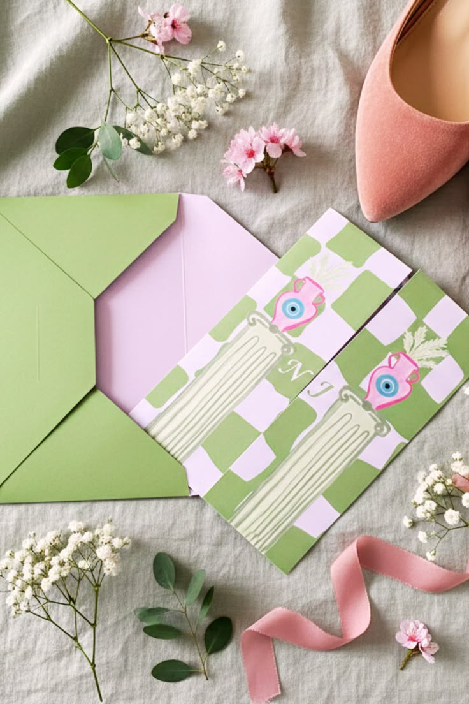

Every suite begins with a conversation about *place*. For this Athens wedding, it was the Acropolis at golden hour and a vase the couple found on their first holiday together.

## Starting with the palette

I paint a small set of studies before anything else. Here, a pale sky blue with deep ink-blue linework felt right: cool, calm, and very Aegean.

## Carrying it across the suite

Once the artwork is agreed, it travels everywhere:

- the save the date
- the invitation and envelope liner
- menus and place cards
- little illustrated name cards for the table

> The best stationery doesn't just tell your guests where to be. It tells them something about you.

Want something like this? Head to the contact form on the home page and tell me about your day.
